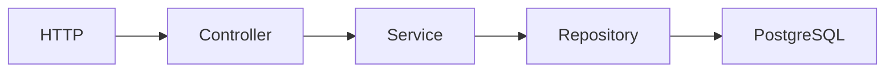

# Pismo Transactions Tech Case

## Overview

A small REST API for creating accounts, recording financial transactions, and discharging credit payments against previous debits.

### Original tech case requirements

- Create an account with `POST /accounts`.
- Retrieve an account with `GET /accounts/{accountId}`.
- Create an account transaction with `POST /transactions`.

### Pair-programming extension

- Preserve `amount` as the original transaction value and maintain the current value in `balance`.
- When a credit voucher is created, discharge previous outstanding debits from the same account, oldest first.
- Allow total or partial discharge and keep any unused credit in the credit transaction's `balance`.
- Do not use an existing credit balance when a new debit is created; only a new credit triggers discharge.

## Tech Stack

- Java 25
- Spring Boot 4.1.1
- Spring Web MVC, Spring Data JPA, and Jakarta Validation
- PostgreSQL 17 and Flyway
- JUnit Jupiter and Testcontainers 2.0.5
- Docker and Docker Compose
- springdoc-openapi / Swagger UI

## Architecture

Code is grouped by feature (`account` and `transaction`). The small `shared` package contains only cross-cutting error handling and clock configuration.



- Controllers translate HTTP requests and responses.
- Services implement the use cases and transaction boundaries.
- Repositories contain persistence access only.
- DTOs keep the external API contract separate from JPA entities.
- `OperationType` owns each operation's debit or credit behavior.

## Business Rules

| `operation_type_id` | Operation | Effect | Stored amount for input `100.00` |
|---:|---|---|---:|
| 1 | Normal Purchase | Debit | `-100.00` |
| 2 | Purchase with installments | Debit | `-100.00` |
| 3 | Withdrawal | Debit | `-100.00` |
| 4 | Credit Voucher | Credit | `100.00` |

The API accepts a positive magnitude only. The domain applies the correct sign from `OperationType`; clients cannot submit pre-signed amounts.

Every transaction starts with `balance` equal to its signed `amount`. The `amount` remains the immutable original value, while `balance` represents the value still available or outstanding.

Creating a credit voucher discharges outstanding debits from the same account, oldest first. A discharge can be total or partial. Creating a debit does not consume a credit balance left by an earlier transaction.

The credit and all affected debits are updated in one database transaction. Outstanding debit rows are pessimistically locked while the discharge runs so concurrent credits cannot consume the same balance.

## Running the Application

Requirements: Docker with Docker Compose.

```bash
./run
```

This runs `docker compose up --build` and starts both PostgreSQL and the application. The API is available at `http://localhost:8080`.

The equivalent command is:

```bash
docker compose up --build
```

Stop and remove the containers with:

```bash
docker compose down
```

The Compose file uses development-only defaults. Override them when needed:

| Variable | Default |
|---|---|
| `DB_HOST` | `localhost` outside Compose / `postgres` inside Compose |
| `DB_PORT` | `5432` |
| `DB_NAME` | `pismo` |
| `DB_USERNAME` | `pismo` |
| `DB_PASSWORD` | `pismo` |

## Running Tests

Requirements: Java 25 and a running Docker engine. Integration tests use a disposable PostgreSQL container and exercise HTTP serialization, validation, Flyway, JPA, and the real database together.

```bash
./mvnw clean test
```

On Windows PowerShell:

```powershell
.\mvnw.cmd clean test
```

Pure unit tests cover debit/credit signs and discharge calculations without mocks. The API integration tests also cover FIFO discharge, partial payments, remaining credit, account isolation, Flyway migrations, and the rule that debits do not trigger discharge.

## API

### Create an account

```bash
curl -i -X POST http://localhost:8080/accounts \
  -H 'Content-Type: application/json' \
  -d '{"document_number":"12345678900"}'
```

Returns `201 Created`, a `Location` header, and:

```json
{
  "account_id": 1,
  "document_number": "12345678900"
}
```

### Retrieve an account

```bash
curl -i http://localhost:8080/accounts/1
```

Returns `200 OK`, or `404 Not Found` when the account does not exist.

### Create a transaction

```bash
curl -i -X POST http://localhost:8080/transactions \
  -H 'Content-Type: application/json' \
  -d '{"account_id":1,"operation_type_id":1,"amount":100.00}'
```

Returns `201 Created`. For this debit example, the response and database contain:

```json
{
  "transaction_id": 1,
  "account_id": 1,
  "operation_type_id": 1,
  "amount": -100.00,
  "balance": -100.00,
  "event_date": "2026-10-13T12:00:00Z"
}
```

For a credit voucher, `balance` contains the credit left after automatically discharging previous debits from the same account.

Interactive documentation is available at `http://localhost:8080/swagger-ui.html`; the OpenAPI document is at `http://localhost:8080/v3/api-docs`.

## Error Responses

Errors have one predictable shape:

```json
{
  "timestamp": "2026-10-07T12:00:00Z",
  "status": 404,
  "error": "Not Found",
  "message": "Account 10 was not found",
  "path": "/accounts/10"
}
```

- Invalid request data and unknown operation type codes return `400 Bad Request`.
- A missing account returns `404 Not Found`.
- A duplicate `document_number` returns `409 Conflict`.

An operation type is treated as a closed request code rather than an exposed resource, so an unknown `operation_type_id` is a `400` instead of a `404`.

## Database Migrations

Flyway applies the schema before JPA validates it:

1. `V1__create_tables.sql` creates `accounts`, `operation_types`, and `transactions`, including unique, foreign-key, not-null, and non-zero constraints.
2. `V2__seed_operation_types.sql` inserts the four operation types required by the case.
3. `V3__add_transaction_balance.sql` adds `balance`, initializes existing rows with `balance = amount`, makes the column mandatory, and enforces `amount <= balance <= 0` for debits and `0 <= balance <= amount` for credits.

Existing migrations are never edited. Hibernate is configured with `ddl-auto=validate`; Flyway changes the schema and Hibernate only verifies that it matches the JPA model.
